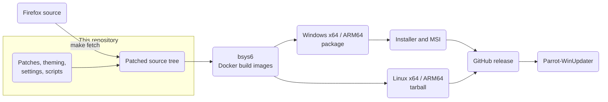

> [!NOTE]
> **Forked from [LibreWolf](https://librewolf.dev/librewolf/source)**

---

<div align="center">

# 

A privacy-focused Firefox fork with a monochrome design, based on LibreWolf.

<p align="center">
  <a href="https://github.com/BentendoYT/Parrot-Browser/releases"></a>
  <a href="https://bentendo.dev"></a>
</p>

</div>

This repository contains everything that makes up Parrot: the patches, the theming,
the preferences (in [settings/](./settings)), the installer and the scripts, Makefile and
GitHub Actions workflows that build it.

## About

Parrot starts from [LibreWolf](https://librewolf.net), which in turn is a hardened build of
Mozilla Firefox, and keeps its privacy and security defaults. The Firefox version it is based on is
stored in [`version`](./version).

### What Parrot changes

- **Name and executable.** The app is called Parrot and the program is `parrot.exe` on Windows
  (`parrot` on Linux). Internal names that other parts depend on, for example the profile folder
  and some IDs, still use LibreWolf's names on purpose.
- **Monochrome design.** Purple and blue accents are replaced by neutral white and gray tones, in both
  the new Nova interface and the classic one. This is done by patches and by the
  scripts [`parrot-nova-colors.py`](./scripts/parrot-nova-colors.py),
  [`parrot-ui-polish.py`](./scripts/parrot-ui-polish.py) and
  [`parrot-settings-fixes.py`](./scripts/parrot-settings-fixes.py).
- **Parrot links.** Help and support links lead to the Parrot
  [wiki](https://github.com/BentendoYT/Parrot-Browser/wiki/FAQ) and issue tracker instead of LibreWolf's pages.
- **Windows installer and updater.** A dark-themed installer, an MSI package for managed installs and
  [Parrot-WinUpdater](https://github.com/BentendoYT/Parrot-winupdater), see [Install](#install).
- **Own build pipeline.** Everything is built by [GitHub Actions](./.github/workflows)
  for Windows (x64, ARM64) and Linux (x64, ARM64).

### Defaults inherited from LibreWolf

- Telemetry and studies are disabled, and so is the built-in Firefox updater.
- Fingerprinting resistance (`privacy.resistFingerprinting`) is on by default.
- HTTPS-only mode is enabled and sponsored or web suggestions are off.
- uBlock Origin is installed by policy.

The complete list is in [`settings/parrot.cfg`](./settings/parrot.cfg) and
[`settings/distribution/policies.json`](./settings/distribution/policies.json).

## Install

Get the files from the [Releases](https://github.com/BentendoYT/Parrot-Browser/releases) page.
Verify a download with the checksums in `sha256sums.txt`.

| File | What it is |
| --- | --- |
| `parrot-<version>-windows-x86_64-setup.exe` | Windows installer for 64-bit Intel/AMD PCs |
| `parrot-<version>-windows-arm64-setup.exe` | Windows installer for ARM64 PCs (only installs on ARM64 Windows) |
| `parrot-<version>-windows-x86_64.msi` | MSI package for managed installs (x64 only) |
| `parrot-<version>-windows-<arch>-package.zip` | The unpacked Windows build, without an installer |
| `parrot-<version>-linux-<arch>-package.tar.xz` | Linux build as a tarball |

The installer works per machine and needs administrator rights. For unattended installs use
`parrot-<version>-windows-x86_64-setup.exe /S` (optionally with `/D=<folder>` as the last argument)
or `msiexec /i parrot-<version>-windows-x86_64.msi /qn`.

> [!NOTE]
> The builds are not code-signed yet, so Windows SmartScreen may show a warning.
> Windows x64 is the main, best tested target. The ARM64 and Linux builds are new.

### Updates

The built-in Firefox updater is disabled. On Windows, [Parrot-WinUpdater](https://github.com/BentendoYT/Parrot-winupdater)
can update Parrot for you. It is an optional component of the installer and checks the
[Releases](https://github.com/BentendoYT/Parrot-Browser/releases) page. It replaces Parrot by running
the newest setup, so do not use it on top of an MSI installation. Updating the MSI works by installing
the newer MSI.

## How it works



1. `make fetch` downloads the Firefox source named in [`version`](./version).
2. [`scripts/librewolf-patches.py`](./scripts/librewolf-patches.py) applies the patches listed in
   [`assets/patches.txt`](./assets/patches.txt), copies the theming from [`themes/`](./themes) and runs the
   Parrot scripts listed above. They are written to be re-runnable.
3. The tree is built with LibreWolf's [bsys6](https://librewolf.dev/librewolf/bsys6) Docker images, which
   cross-compile the Windows and Linux builds. The compiler options are in
   [`assets/mozconfig.new`](./assets/mozconfig.new).
4. The Windows packages are turned into an installer
   ([`assets/installer`](./assets/installer), built with NSIS) and an MSI.
5. A release job publishes everything. Its tag is the version stored in `parrot.exe`,
   which is what Parrot-WinUpdater compares against.

### Repository layout

| Path | Contents |
| --- | --- |
| [`patches/`](./patches) | Patches for the Firefox source, in the order of [`assets/patches.txt`](./assets/patches.txt) |
| [`themes/`](./themes) | Branding and theming files that are copied into the source tree |
| [`settings/`](./settings) | Default preferences (`parrot.cfg`) and policies |
| [`scripts/`](./scripts) | Patch script, helpers and the installer and package scripts |
| [`assets/`](./assets) | Build configuration, icons and the installer |
| [`l10n/`](./l10n) | Localization files |
| [`.github/workflows/`](./.github/workflows) | The build, installer and release workflows |

## Build

### Build: GitHub Actions

Fork the repository and start a workflow from the **Actions** tab:

| Workflow | What it does |
| --- | --- |
| **Parrot - Build all platforms** | Builds Windows x64, Windows ARM64, Linux x64 and Linux ARM64 (or just one), then the Windows installers and the x64 MSI. With `publish_release` it publishes a GitHub release. |
| **Parrot - Windows Build** | The original Windows x64 build with installer. |
| **Rebuild installer from an existing build** | Rebuilds only the installer from the package of an earlier run, in a few minutes. |
| **Diagnose Windows build image** | Checks the Windows build image (Windows SDK, toolchain) without building. |

Every platform is a separate job on its own runner and takes hours. The Windows jobs use a pinned
build image, see the comment in [`build-all.yml`](./.github/workflows/build-all.yml).

### Build: Linux, from this repository

1. Clone the repository:

   ```bash
   git clone https://github.com/BentendoYT/Parrot-Browser.git
   cd Parrot-Browser
   ```

2. Fetch and patch the source, and bootstrap your system. You only have to bootstrap once:

   ```bash
   make dir && make bootstrap
   ```

3. Build and package or run Parrot:

   ```bash
   make build && make package
   # or
   make build && make run
   ```

> [!NOTE]
> The Windows and ARM64 builds are made with the cross-compiling Docker images in GitHub Actions.
> Building them on your own machine is not documented here.

## Development

### Creating a patch

The easiest way to make a patch is to work in the patched source folder:

```bash
make fetch
./scripts/git-patchtree.sh patches/<existing-patch>.patch
```

Change the source the way you want, keeping in mind to `git add` new files and to commit before the
diff. Then create the patch:

```bash
cd librewolf-$(cat version)
git diff 4b825dc642cb6eb9a060e54bf8d69288fbee4904 HEAD > ../my-patch-name.patch
```

That ID is the hash of the empty tree, so the patch contains everything since the first commit,
which is called `initial`. Put the new patch into [`patches/`](./patches) and add it to
[`assets/patches.txt`](./assets/patches.txt).

For changes that are better expressed as an edit of a few lines than as a patch, the `parrot-*.py`
scripts replace anchored text and refuse to run if an anchor is missing or ambiguous. That makes them
safe against Firefox updates, and re-running them changes nothing.

### Contributing upstream

Mozilla only accepts patches against Nightly. See the
[Firefox Source Tree Documentation](https://firefox-source-docs.mozilla.org/) and the
[contribution quick reference](https://firefox-source-docs.mozilla.org/contributing/contribution_quickref.html)
for how to test your change and send it to Mozilla.

## Help

- Questions: [FAQ](https://github.com/BentendoYT/Parrot-Browser/wiki/FAQ)
- Bugs and ideas: [Issues](https://github.com/BentendoYT/Parrot-Browser/issues)
- Website: [bentendo.dev](https://bentendo.dev)

## Credits and license

Parrot builds on the work of [LibreWolf](https://librewolf.net) and of
[Mozilla](https://www.mozilla.org/firefox/), and on the privacy research behind LibreWolf's settings.
Many thanks to everyone who contributed to them.

The code is licensed under the [Mozilla Public License 2.0](./LICENSE).
